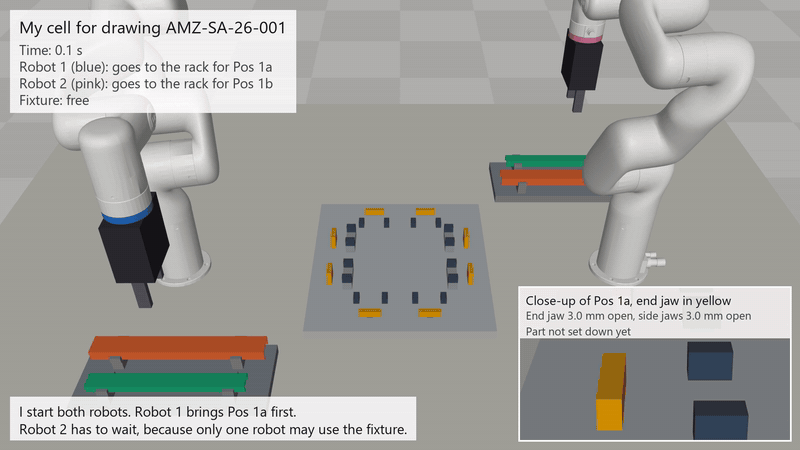

# AMZ-SA-26-001

My assignment for the position Scientific Assistant in Industrial Robotics and Manufacturing at am|z, ETH Zurich.

[](video.mp4)

| File | Content |
| --- | --- |
| `AMZ-SA-26-001_report.pdf` | my report |
| `simulation.py` | my simulation in MuJoCo |
| `fixture_with_profiles.step` | CAD model of my fixture with the four profiles |
| `video.mp4` | video of my simulation |
| `xarm6_meshes/` | xArm6 models from UFACTORY, BSD-3-Clause licence |

Run the simulation:

```
pip install "mujoco>=3.3" numpy
python simulation.py
```
